<div align="center">


# Adigam AI

### An adaptive exam-prep tutor that finds the wrong idea behind a wrong answer, then aims the next questions at that idea to see whether it still holds.

**[Agentic AI Hackathon](https://theproductspace.in/agentic-ai-hackathon) · Product Space**<br/>
Problem Statement 02 — Adaptive exam-prep tutor with a learner model

[](server)
[](frontend)
[](database)
[](server/internal/ratelimit)
[](server/internal/ai)

**[Open the live app → adigam.vercel.app](https://adigam.vercel.app)**

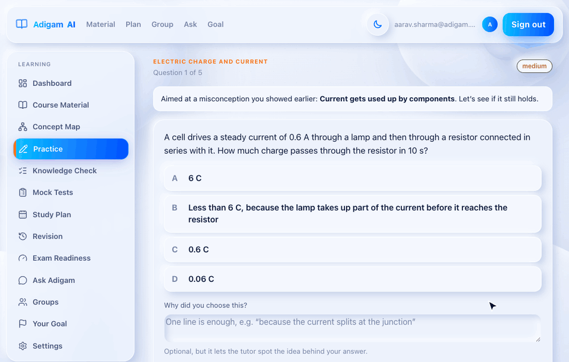

<sub>A student picks a wrong option and writes why. Adigam names the misconception ("Current gets used up by components"), and the teacher dashboard shows it held by 21 of 24 students, with his sentence as the top quote.</sub>

</div>

---

## Demo logins

| Role | Email | Password |
|---|---|---|
| Teacher | `teacher@adigam.example` | `AdigamDemo#2026` |
| Student | `aarav.sharma@adigam.example` | `AdigamDemo#2026` |

The demo class is **Class 10-B · Physics**: 24 students on the Class 10 Physics
syllabus (NCERT chapters 9 to 12), with answers, reasoning and mastery already recorded. Every student
signs in with the same password, e.g. `ananya.iyer@adigam.example`.

> The API runs on a free hosting plan. If nobody has used it for a while, the first request can take a
> little longer while the server wakes up.

---

## Try it in 2 minutes

1. **Teacher dashboard.** Sign in as the teacher, open **Groups**, then **Class 10-B · Physics → Open class
   dashboard**. You see class-wide gaps ranked by priority, the misconceptions behind them in students' own
   words, and a student × topic heatmap. Press **Generate re-teach plan** for a timed lesson and student groups.
2. **Practice with reasoning.** Sign out and sign in as Aarav. The dashboard's **Do this next** says which
   topic to practise and why. Open **Practice → Start practice**, choose an option and fill in **Why did you
   choose this?** before **Submit answer**. The feedback shows the likely misconception, a reply to your
   reasoning, the explanation and how your mastery moved.
3. **Concept map.** Open **Concept Map**: every concept of the syllabus, its prerequisites, and your mastery
   on each (strong, getting there, weak, not started). Click a topic to practise exactly that one.
4. **Targeted practice.** Questions aimed at a misconception you have shown come first in a session, under
   the banner *"Aimed at a misconception you showed earlier: …"*. Their wrong options are the ones that
   belief leads to, so the answer shows whether it still holds.
5. **Tutor.** Open **Ask Adigam** and ask a study question, e.g. *"Why is the current the same before and
   after a bulb in a series circuit?"*. Then ask something off-topic (*"Who won the IPL match today?"*). It
   answers the first and politely refuses the second.

---

## Problem statement 02: Adaptive exam-prep tutor with a learner model

| # | Requirement | Where in the app | How it works |
|---|---|---|---|
| 1 | **Diagnostic** | **Knowledge Check** (`/assessment`) | A broad paper: 15 questions by default (6 to 25), one per topic, at most 4 per subject, round-robin across subjects heaviest exam weight first. Subjects with no questions are named instead of silently skipped. Answers go into the same attempt log as practice. [`assessment/diagnostic.go`](server/internal/assessment/diagnostic.go) |
| 2 | **Concept graph** | **Concept Map** (`/concept-map`) | Topics with prerequisite edges (the seeded syllabus has 4 chapters and 28 concepts), each coloured by the learner's mastery (strong 70+, weak under 40). Prerequisites steer the next topic too: if a prerequisite of the top-ranked topic is below 60 mastery, it is practised first. For uploaded course material, Claude builds the course map (topics, key concepts, prerequisites). [`adaptive/recommendation.go`](server/internal/adaptive/recommendation.go) |
| 3 | **Per-concept mastery** | Dashboard, Concept Map, feedback after every answer | **Recomputed from the attempt log** after every answer, never incremented in place: 0.4 × recent accuracy (last 10) + 0.25 × historical accuracy + 0.25 × difficulty-weighted accuracy (easy 1, medium 2, hard 3) + 0.1 × consistency. With little evidence the score is pulled towards a neutral 35 (weight n/(n+5)), and a topic idle for 30 days loses up to 15%. [`learner/mastery.go`](server/internal/learner/mastery.go) |
| 4 | **Targeted question generation + difficulty calibration** | **Practice** | Claude writes questions (MCQ, multi-select, numeric, short answer) and labels every wrong option with the misconception that leads to it. Each one is **re-solved independently** and shown only if both answers agree. Difficulty is **measured**: each question has an **Elo rating** that real answers move (K = max(0.15, 0.6/√(n+1))). Until **5 answers** the author's easy/medium/hard label decides its level; after that, its measured rating does. Within a level, questions are served nearest the rating this learner should get right **70%** of the time. [`learner/calibration.go`](server/internal/learner/calibration.go) |
| 5 | **Misconception detection from reasoning** | **Why did you choose this?** box in Practice | Claude judges the learner's one line as **sound**, **flawed** or **missing**, names the wrong belief (reusing a known label when one fits), quotes the evidence and replies. The reasoning outranks the option: a wrong answer reasoned soundly is a slip with no misconception, and a right answer given for a wrong reason still records the wrong idea. [`web/practice/reasoning.go`](server/internal/web/practice/reasoning.go) |
| 6 | **Spaced repetition** | **Revision** (`/revision`) | **SM-2 per topic**, graded by measured accuracy rather than self-rating: pass at 80%, lapse under 50% (back to 1 day), 1.2× growth in between. Intervals 1 → 3 → × ease (1.3 to 3.0), at most 60 days, and **capped so every review lands before the exam date** (with a 1-day buffer). [`learner/srs.go`](server/internal/learner/srs.go) |
| 7 | **Teacher dashboard** | **Groups → class → Open class dashboard** (`/classes/:id`) | KPIs, **class-wide gaps ranked by priority = (1 − avg/100) × (0.5 + share below 50%) × (1 + downstream/5)**, where downstream counts the later topics that depend on it. Misconceptions with up to 3 students' own quotes, a student × topic heatmap (weakest first) and an AI re-teach plan. [`groups/class.go`](server/internal/groups/class.go) |

**Closing the loop.** When a learner has shown a misconception on a topic, up to 2 questions whose wrong
option exposes it are moved to the front of their next session on that topic. If the bank has none they
have not seen, a batch written to expose those beliefs is generated in the background, at most once every 6
hours per learner and topic.
[`web/practice/misconceptions.go`](server/internal/web/practice/misconceptions.go)

**Deterministic where it can be.** Mastery, difficulty, scheduling, selection, grading of choice and numeric
answers, and gap priority are plain Go arithmetic with unit tests. Claude is used where language is needed:
writing and checking questions, reading reasoning, explaining.

---

## How the AI is used

Adigam uses **Claude AI** for the language work below ([`server/internal/ai`](server/internal/ai)).

| Call | What it does | Guardrails |
|---|---|---|
| Question author | Writes a batch for a topic and difficulty, each wrong option tagged with its misconception; can be aimed at a learner's own misconceptions | JSON schema; structural validation; existing questions listed so they are not rewritten, exact duplicates never stored; misconception labels quoted as data and capped at 80 chars; one generation per topic at a time (Redis lock); 10 per hour per learner on the manual route |
| Independent answer check | Solves each generated question **cold, without seeing the proposed answer** | Choice: the indexes must match. Numeric: within tolerance. Short: accepted wording or rubric. Any failure leaves the question unverified, and learners can only read verified questions |
| Reasoning check | Verdict `sound` / `flawed` / `missing`, misconception, evidence, feedback | Reasoning capped at 600 chars and fenced in `<reasoning>` with `<` `>` neutralised; JSON schema; unknown verdicts become `missing`; 20 s timeout; on failure the answer is marked as if no reasoning were given |
| Short-answer grader | Marks a typed answer the normalised match did not accept | Answer fenced in `<answer>` and labelled data, not instructions; JSON schema |
| Study-only scope gate | One-word `STUDY` / `OFF_TOPIC` check before the tutor answers | A separate call rather than a rule in the tutor prompt, which a persuasive message can bend; off-topic gets a fixed refusal and the tutor is never called; if the check itself fails, the question is answered |
| Tutor (Ask Adigam) | Answers from the learner's course material with numbered citations, or from general knowledge under a "General knowledge · not from your material" label | Question fenced in `<question>`; citations that point at nothing are removed and an uncited answer is relabelled as general knowledge; 2,000-char questions; 40 per hour |
| Re-teach plan | Headline, timed 3 to 5 step lesson, 2 or 3 student groups | Class data fenced in `<class_data>`; JSON schema; class owner only; 20 per hour; cached 2 minutes per class |
| Syllabus from a goal | Decides whether typed goal text is something to study and writes its syllabus | Fenced input; schema-validated and business-checked before insert; 20 per hour. "Class 10 Physics" resolves to the seeded syllabus with no AI call |
| Course map, OCR, figures, flashcards | Turns uploaded PDFs, slides and video into topics, searchable text and revision cards | JSON schemas; uploads 30 per hour, course map rebuilds 10 per hour |

Every JSON call uses **structured outputs** to constrain the reply to a JSON Schema, and the result is
still validated (the scope gate, the general-knowledge tutor answer and search translation are plain
text). Across every call, refusals and replies cut off at the token limit are errors, never half-parsed;
server-side refusal fallbacks, 2 SDK retries and a 90 s timeout. Rate limits are **per learner, keyed on the verified
user id** in Redis. Without an API key the server still starts and only AI routes answer 503.

**What the model sees.** The tutor gets the topic, the learner's mastery there, a few recently missed
question texts and the question on screen, never a name, email or full history. Question generation gets a
topic name, existing question texts and misconception labels. The re-teach plan gets display names, topic
scores and short reasoning quotes, with no user ids or emails.

---

## Architecture

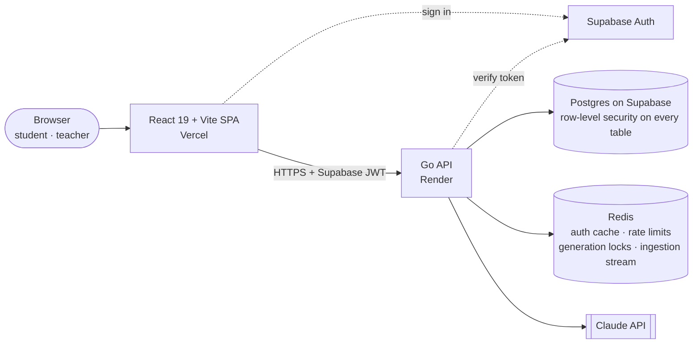

| Part | What it is |
|---|---|
| [`frontend/`](frontend) | React 19, React Router 7, Vite 8, TypeScript, plain CSS design tokens, day and night themes |
| [`server/internal/learner`](server/internal/learner) | Mastery, SM-2 schedule, Elo question calibration, streaks and badges |
| [`server/internal/adaptive`](server/internal/adaptive) | Next best action, difficulty choice, question selection |
| [`server/internal/assessment`](server/internal/assessment) | Grading, diagnostic paper, mock tests |
| [`server/internal/groups`](server/internal/groups) | Class gaps, heatmap rows, the brief for the re-teach plan |
| [`server/internal/ai`](server/internal/ai) | Claude client, every prompt in one file, scope gate, grounded tutor |
| [`server/internal/web`](server/internal/web) | HTTP handlers: `learning` (goals, plan, classes), `practice` (attempts, questions, reasoning), `content` (material, tutor, flashcards) |
| [`server/internal/store`](server/internal/store), `shed`, `ratelimit`, `jobs` | SQL, overload shedding (503 + `Retry-After` past 256 requests in flight), per-learner quotas, Redis Streams ingestion queue |
| [`database/`](database) | Migrations `000` to `035`, seeds, SQL tests |

---

## Screenshots

<table>
<tr>
<td width="50%">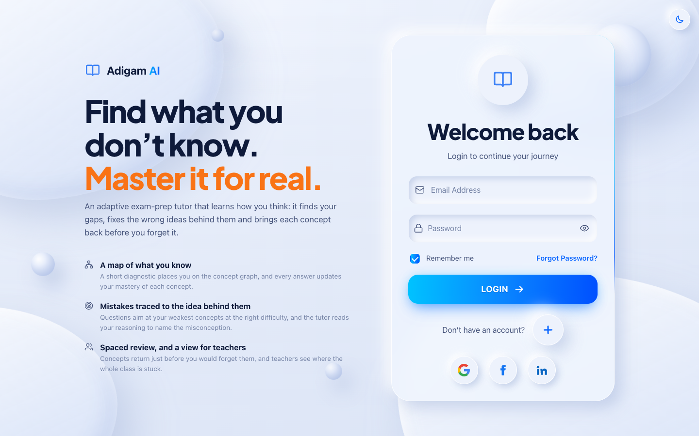<br/><sub><b>Sign in.</b> "Find what you don't know. Master it for real."</sub></td>
<td width="50%">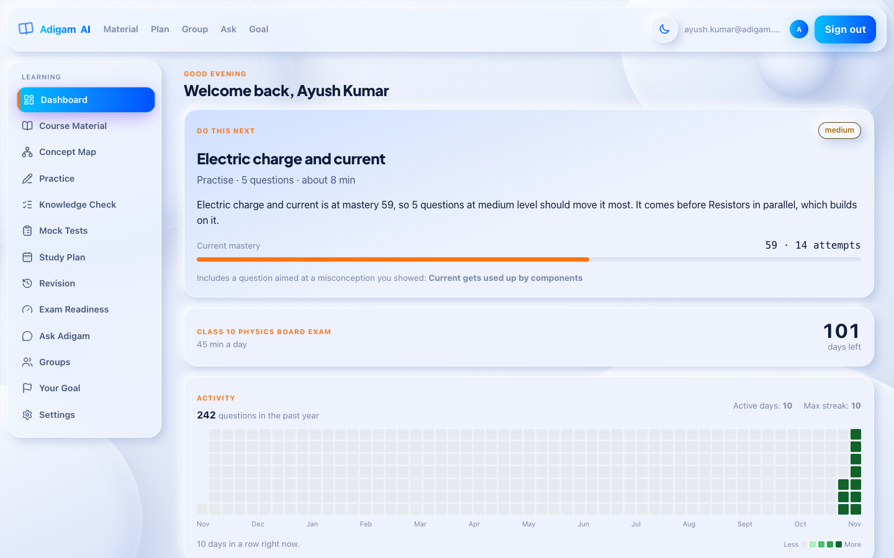<br/><sub><b>Student dashboard.</b> "Do this next" with its reason and current mastery, a note that it includes a question aimed at his misconception, the exam countdown and the activity heatmap.</sub></td>
</tr>
<tr>
<td>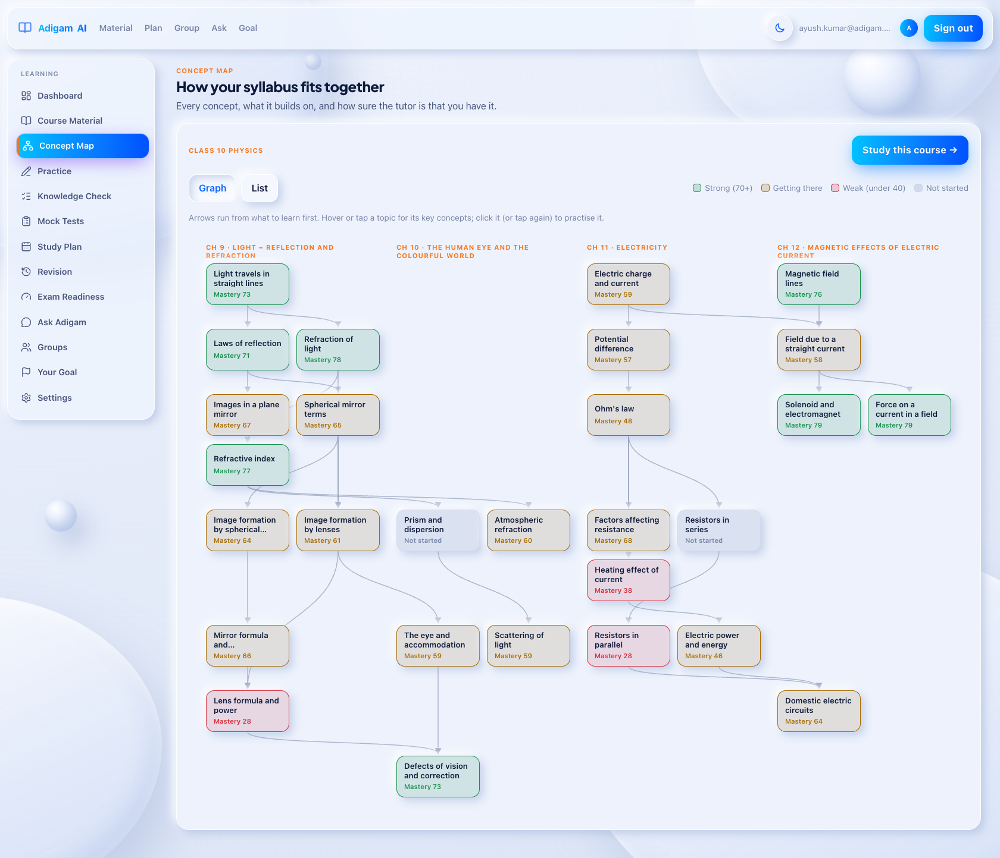<br/><sub><b>Concept map.</b> Prerequisite graph across chapters 9 to 12, each topic coloured by mastery: strong, getting there, weak or not started.</sub></td>
<td>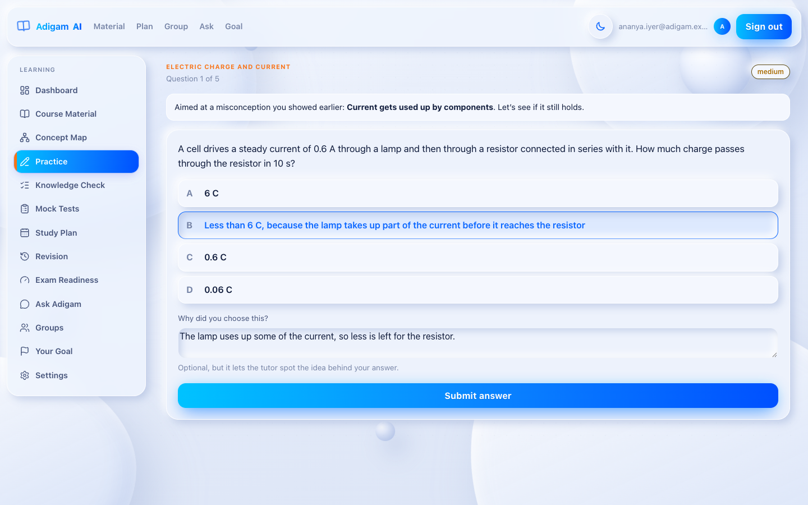<br/><sub><b>Practice with reasoning.</b> Option B chosen, with the reason: "The lamp uses up some of the current, so less is left for the resistor."</sub></td>
</tr>
<tr>
<td>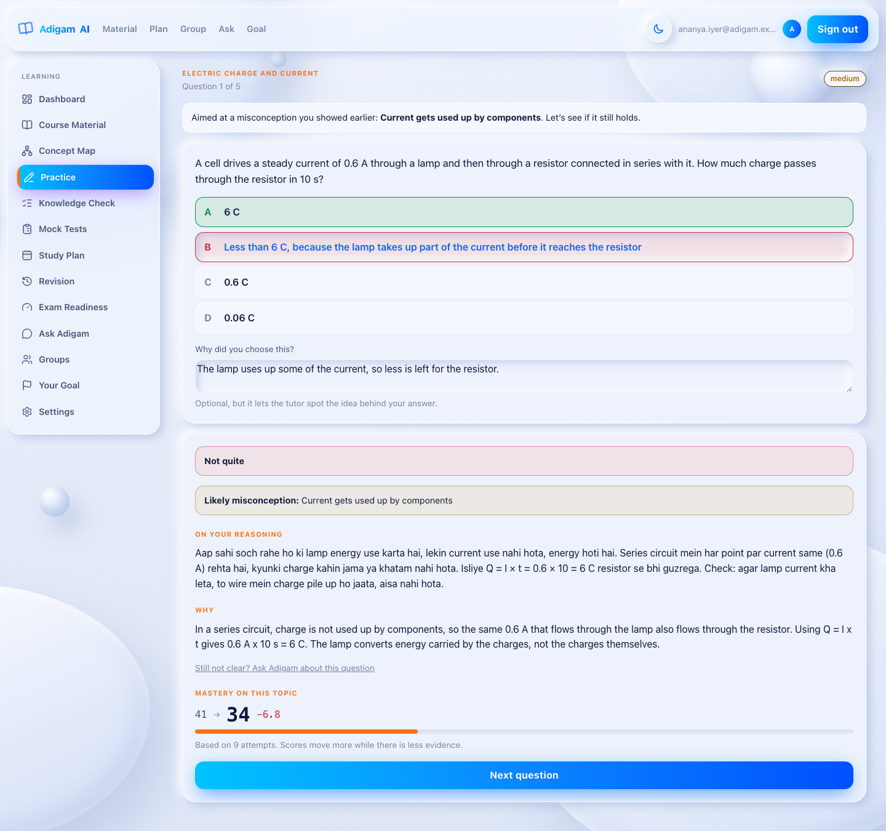<br/><sub><b>Feedback.</b> Correct option in green, chosen in red, "Likely misconception: Current gets used up by components", a reply to the reasoning (in Hinglish in this capture), the explanation and mastery 41 → 34.</sub></td>
<td>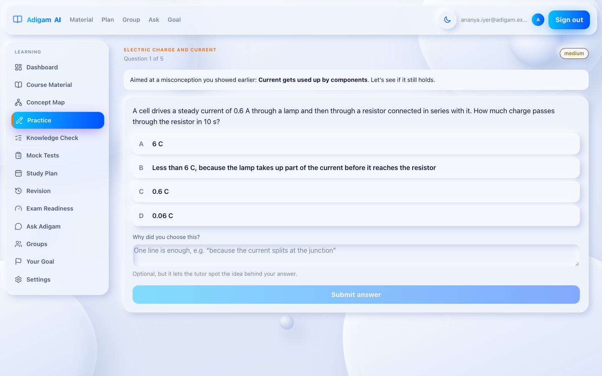<br/><sub><b>Targeted practice.</b> "Aimed at a misconception you showed earlier: Current gets used up by components. Let's see if it still holds."</sub></td>
</tr>
<tr>
<td>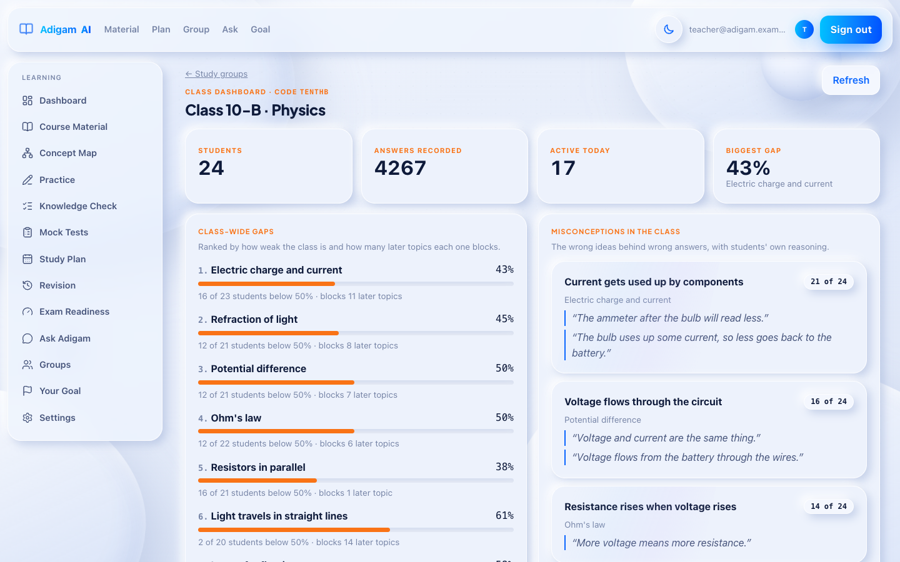<br/><sub><b>Teacher class dashboard.</b> 24 students, 2,327 answers, 21 active today; gaps ranked by weakness and how many later topics each blocks; misconceptions with students' own quotes.</sub></td>
<td>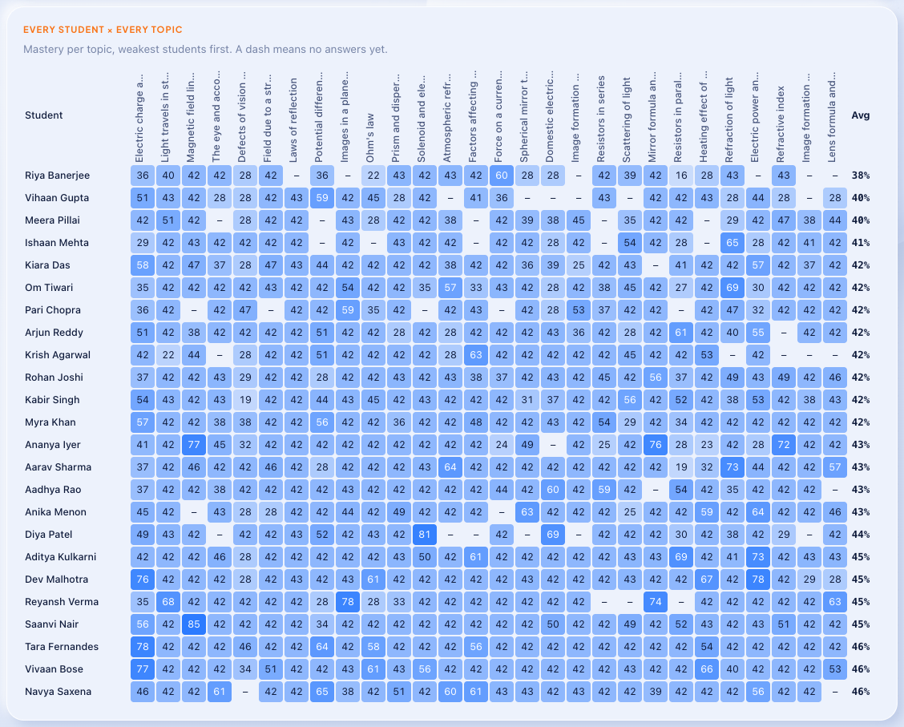<br/><sub><b>Heatmap.</b> 24 students × 28 topics, weakest students first, with each student's average.</sub></td>
</tr>
<tr>
<td>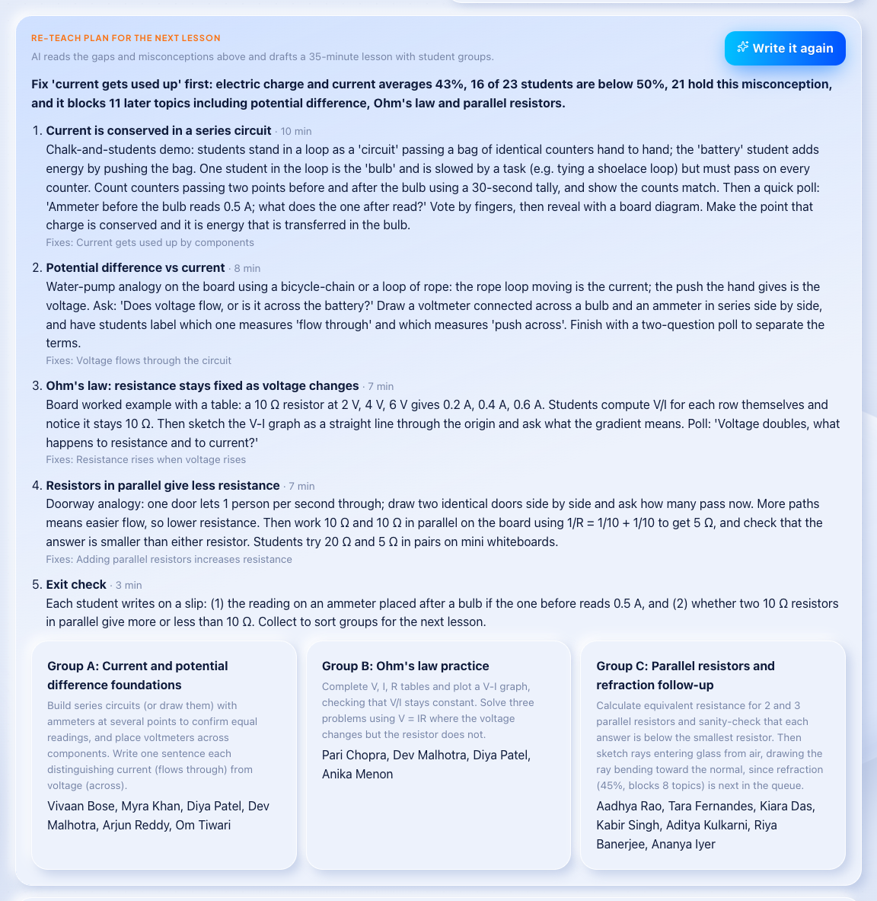<br/><sub><b>Re-teach plan.</b> A headline, a timed 4-step lesson with "Fixes:" links to misconceptions, and three named student groups.</sub></td>
<td>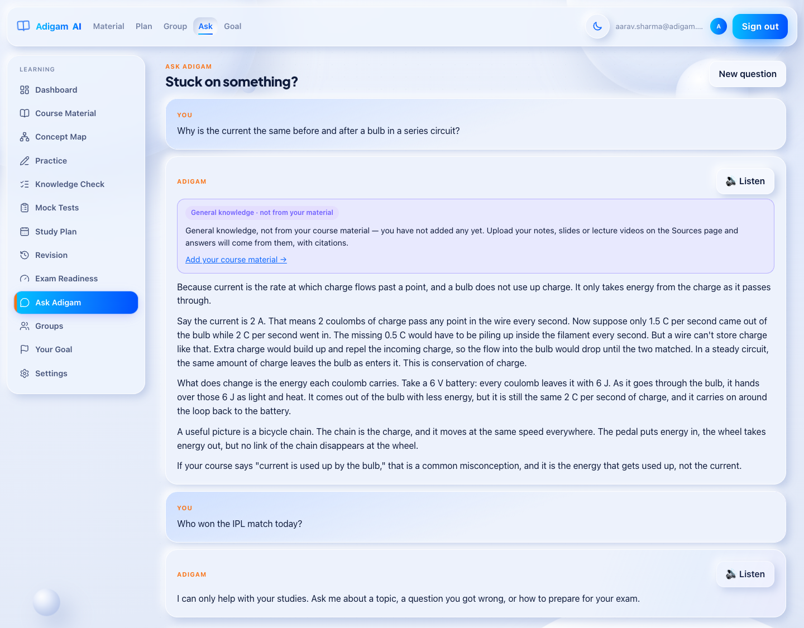<br/><sub><b>Ask Adigam.</b> Answers a series-circuit question under a general-knowledge label, then refuses "Who won the IPL match today?" with "I can only help with your studies…"</sub></td>
</tr>
<tr>
<td>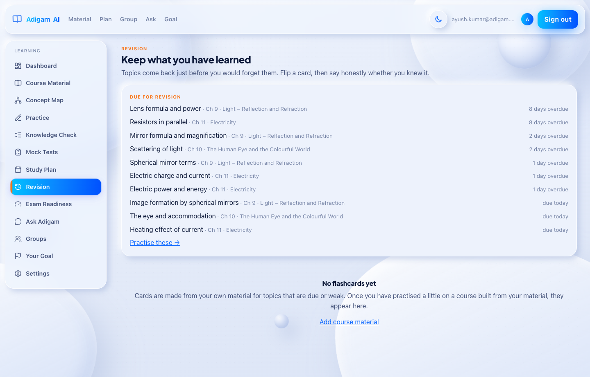<br/><sub><b>Revision.</b> Topics due for revision with chapter and days overdue, plus "Practise these".</sub></td>
<td>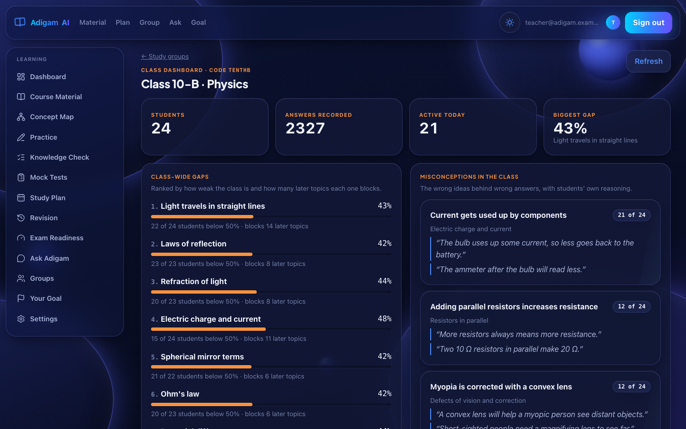<br/><sub><b>Dark mode.</b> The class dashboard with KPIs, gaps and misconceptions.</sub></td>
</tr>
</table>

---

## Quality

**Tests**

| Suite | Size | Runs |
|---|---|---|
| Go (`go test -race ./...`) | 269 test functions in 51 files across 21 packages: mastery, SM-2, Elo calibration, selection, class gaps, prompts, scope gate, rate limits, shedding, handlers | CI on every push and pull request to `main` |
| Frontend (Vitest) | 3 files, 20 cases | CI, together with lint, Prettier check, type check and production build |
| SQL (`database/tests/`) | 8 files on schema, RLS and grants | By hand against a database; they roll back |

CI ([`.github/workflows/ci.yml`](.github/workflows/ci.yml)) also runs `gofmt`, `go vet`, and Linux and
Windows builds, with a real Redis service. Database integration tests skip without `DATABASE_URL`, so no
database credentials sit in CI.

**Load test (local)**

Goal: 28,000 requests per second. On an 8-core M1 laptop over loopback (load generator on the same
machine), every **1,000,000-request** run against the shallow `GET /api/v1/health` endpoint measured
**67,243 to 75,761 req/s**, about 2.4 to 2.7 times the goal. This is the ceiling of the HTTP stack and
router, not of learner endpoints or the hosted deployment.

| Endpoint | Requests | Concurrency | req/s | p50 | p95 | p99 | Errors |
|---|---:|---:|---:|---:|---:|---:|---|
| `GET /api/v1/health` | 1,000,000 | 64 | 67,710 | 0.65 ms | 2.66 ms | 5.12 ms | 0 |
| `GET /api/v1/health` | 1,000,000 | 128 | **75,761** | 1.18 ms | 4.85 ms | 8.79 ms | 0 |
| `GET /api/v1/health` | 1,000,000 | 256 | 67,243 | 2.71 ms | 10.53 ms | 18.47 ms | 0 |
| `GET /api/v1/health` | 1,000,000 | 512 | 68,510 | 5.79 ms | 19.35 ms | 31.95 ms | 1 client transport error |
| `GET /api/v1/health` (rerun) | 1,000,000 | 512 | 74,065 | 5.32 ms | 18.20 ms | 29.46 ms | 0 |
| `GET /api/v1/health/deep` | 5,000 | 16 | 112 | 104.5 ms | 208.3 ms | 1,258.7 ms | 97 × 503 |

<details>
<summary><b>Environment and caveats</b></summary>

- **Where:** Apple M1 laptop, 8 cores, macOS, Go 1.27.2, `ulimit -n 1048576`. The load generator and the
  API ran on the same machine over loopback, so they shared the same 8 cores. Redis was local; Postgres was
  the hosted Supabase database.
- **Load generator:** [`server/cmd/loadgen`](server/cmd/loadgen/main.go), a stdlib-only Go program (N
  goroutines, keep-alive transport with `MaxIdleConnsPerHost = MaxConnsPerHost = concurrency`, fixed
  request count, per-request latency and status codes) that refuses any host other than `localhost` or
  `127.0.0.1`. With the API running: `(cd server && go run ./cmd/loadgen -url http://localhost:4000/api/v1/health -n 1000000 -c 128)`.
- **What `/health` measures:** a handler that writes a JSON envelope with no auth, database or Redis. It is
  the ceiling of the HTTP stack and router, not of learner endpoints. Authenticated, database-backed and AI
  routes are much slower, and only those pass through the 256 in-flight shed limit and the Redis rate
  limiter (so no 429s occurred here).
- **Throughput levels off** at about 67k to 76k req/s from c=64 to c=512 while latency grows with
  concurrency, which points to the CPU being saturated by client and server together.
- **The one error** in 5,000,000 health requests was a client-side transport error in the first c=512 run.
  The server logged nothing, and a clean c=512 rerun did not reproduce it.
- **`/health/deep`** does a connection ping to the hosted Postgres plus a Redis `PING`, so its numbers are
  dominated by the round trip to the hosted database. All 97 `503 DATABASE_UNREACHABLE` responses had one
  cause: two local API instances shared the free-tier session pooler's 15-client limit (12 connections
  each). A single instance, or the transaction pooler (`DB_POOL_MODE=transaction`), should not hit it; this
  was not re-measured.
- **Not the hosted deployment.** These numbers say nothing about the free-tier Render or Vercel
  deployment, which is far smaller and limited by network and instance size. Each configuration ran once
  (c=512 twice); expect run-to-run variance of about ±10%.

</details>

---

## Security and privacy

- **Row-level security on all 26 tables.** Goal, profile, progress, revision, tutor-history and
  practice-selection reads run as the learner: `DB.AsUser` sets the JWT claims and the `authenticated` role
  inside a transaction, so policies apply even if such a query forgets its `WHERE`. Grading, writes, study
  plans, class views and course material use an elevated connection and filter by user id in code.
  ([`db`](server/internal/db), [`020_rls_policies.sql`](database/migrations/020_rls_policies.sql))
- **The answer key never reaches the browser before grading.** A column-level grant lets learners read only
  a question's id, topic, type, body, options, difficulty and marks (plus its measured rating), and only for
  verified questions. The correct answer, explanation and per-option misconception tags are not granted.
  ([`003_questions.sql`](database/migrations/003_questions.sql))
- **Only a class's owner sees its students.** `assertClassOwner` runs before anything is fetched: a
  non-member gets 404, a member who is not the owner gets 403. Learners' own policies are not loosened, and
  students are told what a teacher will see when they join a class. Heatmap rows carry opaque keys
  (`s1`, `s2`, …), never user ids. ([`034_classes.sql`](database/migrations/034_classes.sql))
- **Minimum data to the model**, and learner text fenced as data (see [How the AI is used](#how-the-ai-is-used)).
- **Learners hold no write privilege** on attempts or mastery; the API validates and writes.
- **Per-learner hourly limits** on question generation, the tutor, the re-teach plan, goal lookups and
  uploads, keyed on the verified user id, never on an IP or header.
- **Secrets stay server-side.** The browser only holds the publishable key and its own session. Default
  Supabase grants that bypass RLS (`TRUNCATE` and friends for `anon`/`authenticated`) are revoked by
  migration.

---

## Also in the app

- **Course material:** upload PDFs and slides or add a lecture video; excerpts remember their page, slide
  or timestamp, and tutor citations open them.
- **Study plan** weighted to weak topics, forgetting and the exam date; **mock tests**; **exam readiness**.
- **Revision flashcards**, streaks and badges.
- **Hindi and Hinglish** explanations, voice input and read-aloud.

---

## Run it locally

**Needs:** Go 1.27+, Node 22+, Redis, `psql`, and a Supabase project (Postgres, Auth).

```bash
# Run from the repo root.
export DATABASE_URL=...                    # same value as in server/.env

# 1. Database: every migration in filename order, then the syllabus, then the demo class
for f in database/migrations/*.sql; do psql "$DATABASE_URL" -v ON_ERROR_STOP=1 -1 -f "$f"; done
psql "$DATABASE_URL" -v ON_ERROR_STOP=1 -f database/seed/class10_physics.sql
psql "$DATABASE_URL" -v ON_ERROR_STOP=1 -f database/seed/demo_class.sql

# 2. API (separate terminal; it stays in the foreground)
(cd server && cp .env.example .env)        # fill in the variables below
(cd server && go run ./cmd/api)            # check: http://localhost:4000/api/v1/health/deep

# 3. Frontend (second terminal, from the repo root)
(cd frontend && cp .env.example .env && npm install && npm run dev)   # http://localhost:5173
```

<details>
<summary><b>Environment variables (names only)</b></summary>

| `server/.env` | Purpose |
|---|---|
| `PORT`, `CORS_ORIGINS` | API port and the frontend origins allowed to call it |
| `SUPABASE_URL`, `SUPABASE_PUBLISHABLE_KEY` | Required: token verification |
| `SUPABASE_SECRET_KEY` | Storage for uploaded files (server only, never in the frontend) |
| `DATABASE_URL` | Postgres connection (Supabase session or transaction pooler) |
| `DB_POOL_MODE` | Optional: `transaction` when `DATABASE_URL` is the transaction pooler |
| `ANTHROPIC_API_KEY` | Claude key (without it, AI routes answer 503 and the rest works) |
| `AI_MODEL_HIGH`, `AI_MODEL_STANDARD` | Optional: override the model for each tier |
| `REDIS_URL` | Redis connection |
| `MAX_IN_FLIGHT` | Optional: requests per instance before shedding |

| `frontend/.env` | Purpose |
|---|---|
| `VITE_API_URL` | The API's `/api/v1` base URL |
| `VITE_SUPABASE_URL`, `VITE_SUPABASE_PUBLISHABLE_KEY` | Public by design; every table is behind RLS |

In Supabase, add your local frontend URL to the Auth redirect URLs for password reset and social sign-in.
</details>

**Tests**

```bash
(cd server && go test -race ./...)         # needs a local Redis; database tests run only with DATABASE_URL set
(cd frontend && npm test)                  # Vitest
(cd frontend && npm run lint && npm run build)
```

---

<div align="center">

**Adigam AI** · ADAPT · LEARN · MASTER

Entry for the Agentic AI Hackathon by Product Space · Problem Statement 02

<sub>All rights reserved. See [LICENSE](LICENSE).</sub>

</div>
