<div align="center">


# Adigam AI

### Your course material, turned into a tutor that cites its sources and a study plan that adapts to you.

[](server)
[](frontend)
[](database)
[](server/internal/jobs)
[](server/internal/ai)

<br/>

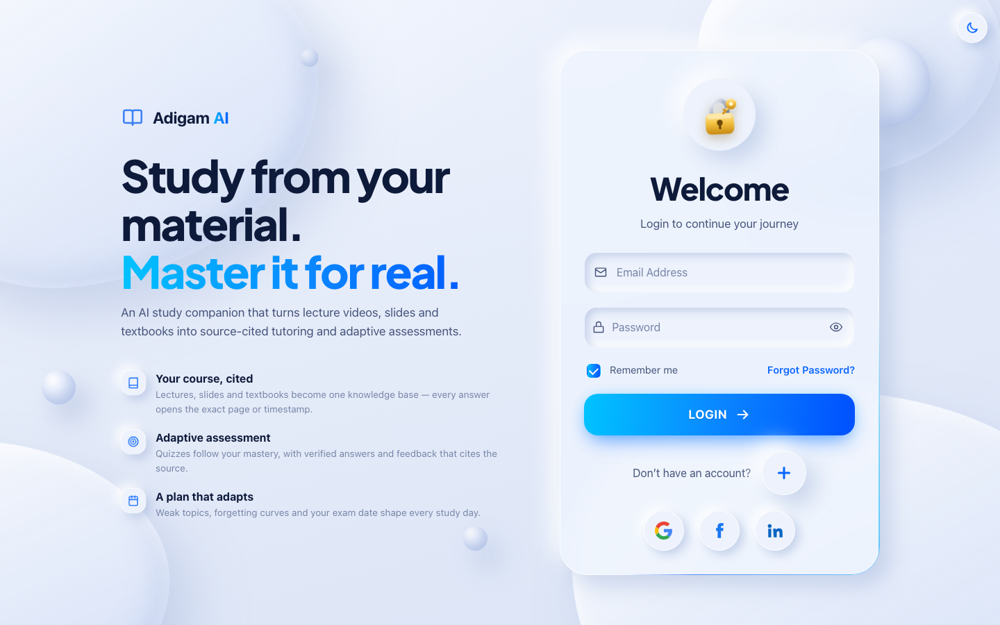
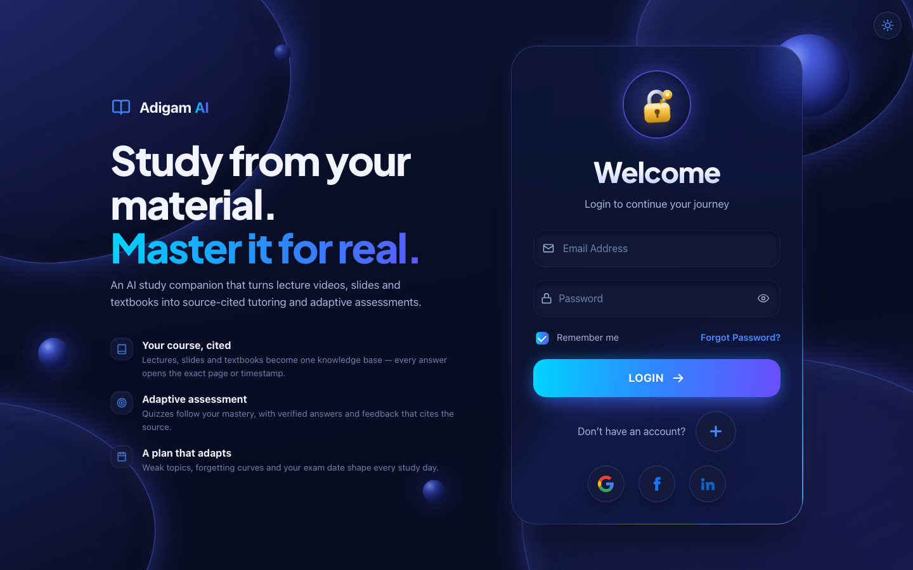

</div>

---

## ✨ What it does

Students study from lecture videos, slides and textbooks scattered across places, and general chatbots
answer without tying anything to the course or to what the student already knows. Adigam fixes both:

| | |
|---|---|
| 📚 **One knowledge base from your material** | Upload PDFs and slide decks, paste a lecture video link. Text, slide images, figures and transcripts become excerpts that remember their **page, slide or timestamp**. |
| 🗺️ **A course map** | Topics, key concepts and prerequisites are identified from the material, and every excerpt is tagged to a topic. |
| 💬 **A tutor that cites, or says it can't** | Answers quote numbered excerpts; one tap opens the exact page, slide or second of video. Anything the material doesn't cover is declined or clearly labelled as outside knowledge. Explains in Hindi/Hinglish too. |
| 🎯 **Adaptive assessment** | Diagnostic, practice and mock exams. Every question generated for the shared bank is checked by a **second, independent solve** before a learner sees it, and repeats are avoided. |
| 📈 **A learner model you can read** | Per-topic mastery from the evidence (recent vs historical accuracy, difficulty, consistency, decay), SM-2 spaced repetition, and an exam-readiness score that shows its working. |
| 🗓️ **A plan that adapts** | Day-by-day sessions weighted to weak topics, forgetting curves and the exam date — rebuilt automatically when you fall behind. |
| 🎙️ **Voice** | Ask by voice, hear answers read aloud. |

---

## 🖼️ Screens

Day mode (soft 3D) and night mode (neon glass) — the same design on a phone and a laptop.

<table>
<tr>
<td width="50%">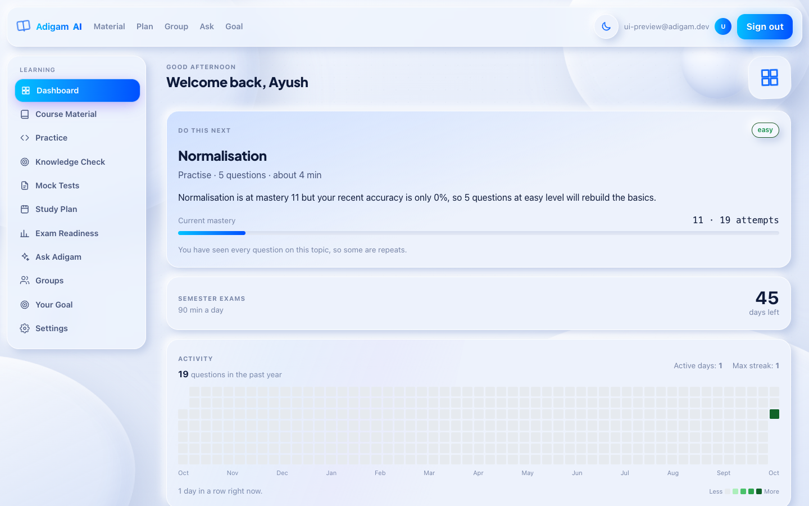</td>
<td width="50%">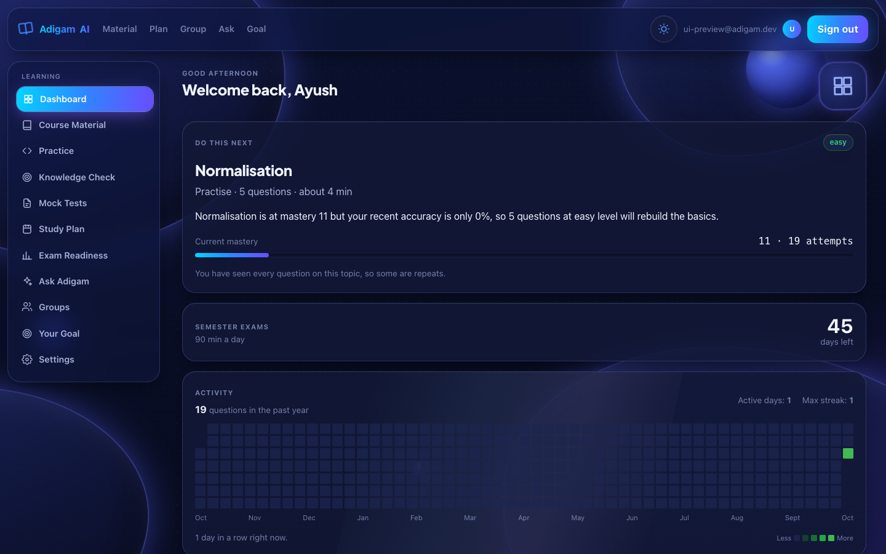</td>
</tr>
<tr>
<td>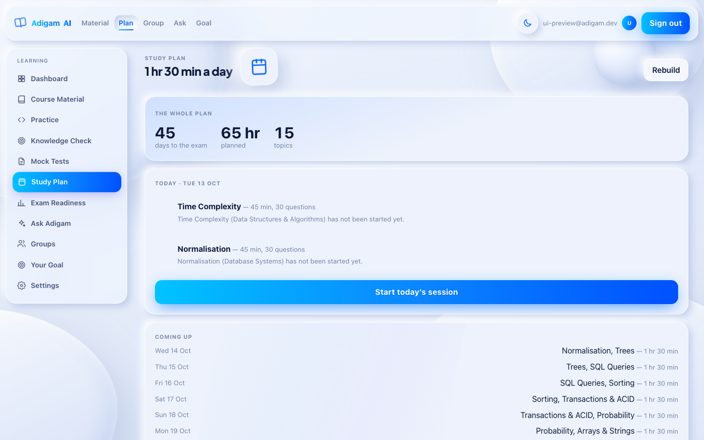</td>
<td>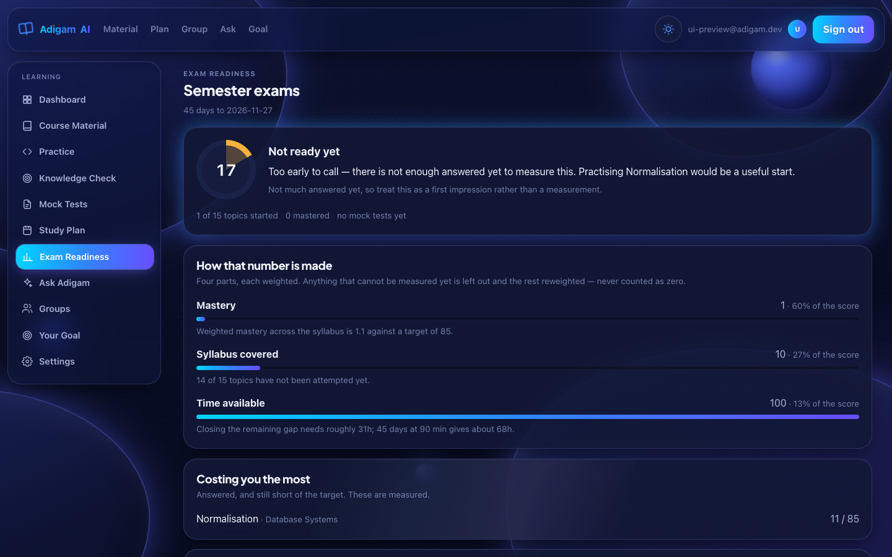</td>
</tr>
<tr>
<td>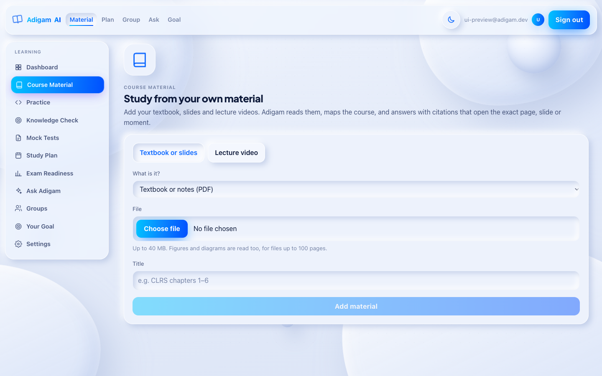</td>
<td>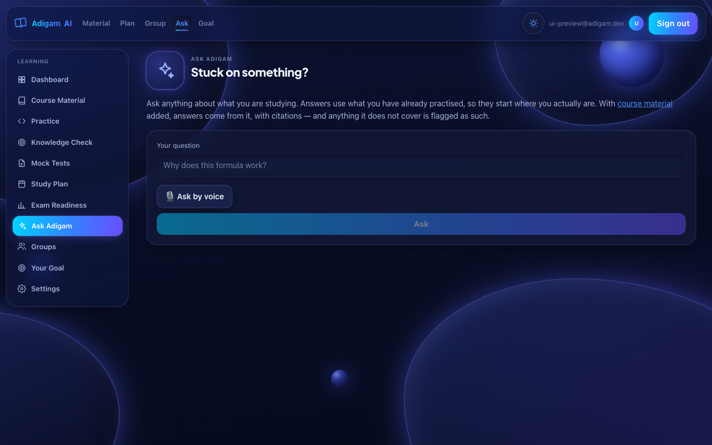</td>
</tr>
</table>

<div align="center">
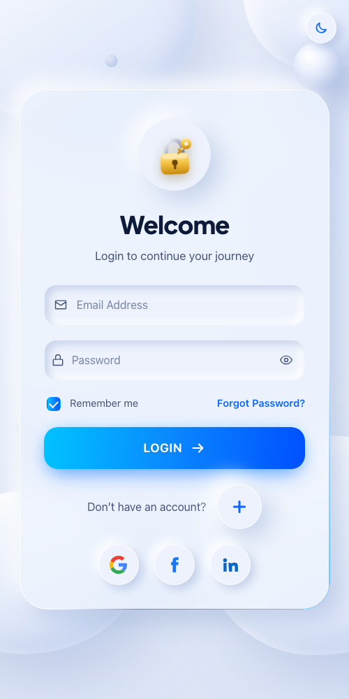
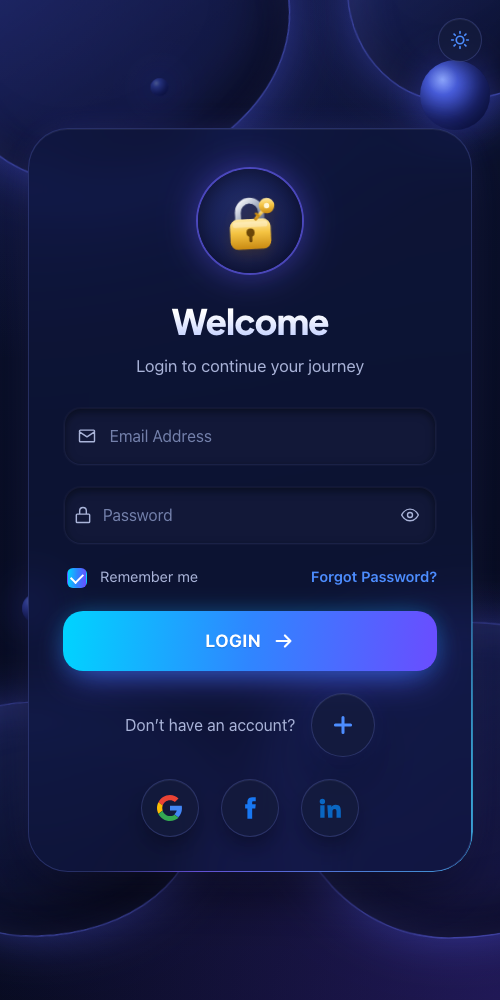
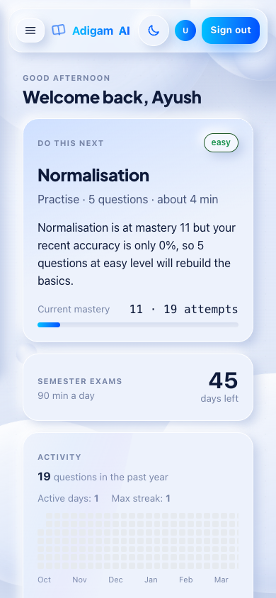
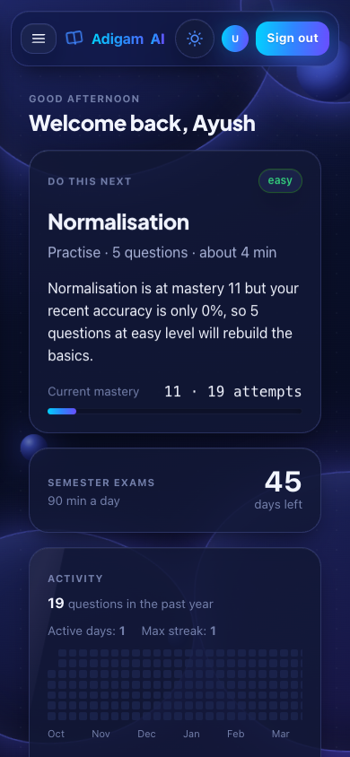
</div>

**Motion, kept smooth:** morphing 3D blobs and floating spheres that lean with the pointer or the phone's
tilt, a light line that runs round the focused field, press-and-ripple feedback on every control, staggered
page entrances. Everything animates `transform`/`opacity` only (compositor, full frame rate), and all of it
switches off under the OS "reduce motion" setting.

---

## 🏗️ Architecture

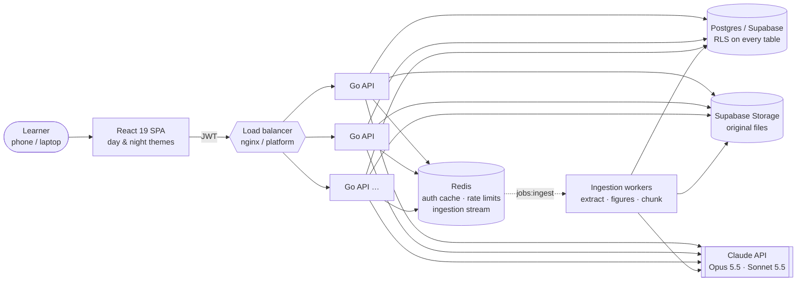

**Design rules the code follows**

- **Arithmetic where arithmetic works, a model where language is needed.** Mastery, readiness, scheduling,
  difficulty and grading are deterministic Go — testable against hand-worked numbers. Claude reads
  material, writes and checks questions, and explains.
- **Security in the database, not just the API.** Reads run as the learner (`DB.AsUser` sets the JWT
  claims and the `authenticated` role inside a transaction), so row-level security applies even if a
  query forgets its `WHERE`. The answer key is a column learners are not granted.
- **Stateless servers.** Auth cache, rate limits and the job queue live in Redis — add instances behind a
  load balancer and capacity grows.
- **Durable ingestion.** Uploads are queued on a Redis Stream and acknowledged only when processed; a
  crash or deploy mid-ingestion is picked up by the next worker, never left "processing" for ever.
- **Graceful under overload.** Beyond `MAX_IN_FLIGHT` requests the server answers `503 SERVER_BUSY` with
  `Retry-After` instead of slowing everyone down; the client retries with jittered backoff.

---

## 🧰 Tech stack

| Layer | Choice |
|---|---|
| Frontend | React 19, React Router 7, Vite 8, TypeScript, plain CSS design tokens (no UI framework) |
| API | **Go 1.27**, `net/http` (stdlib router), pgx v5, go-redis v9, Anthropic Go SDK |
| Data | Postgres on Supabase — migrations 000–032, RLS on all tables, column-level grants |
| Queue & cache | Redis Streams (durable ingestion), Redis rate limits and auth cache |
| AI | **Claude or Gemini**, switchable with one setting. Claude: Opus 5.5 for data that gets stored (questions, answer checks, course maps), Sonnet 5.5 for explanations, server-side refusal fallbacks. Gemini (free tier works): 3.5 Flash / Flash-Lite, falling back to Flash-Lite when Flash is busy |
| Auth | Supabase Auth — email/password, password reset, Google / Facebook / LinkedIn |

---

## 📁 Project structure

```text
AI-tutor/
├── server/                     Go API (the backend)
│   ├── cmd/api/                entry point: config, routes, workers, graceful shutdown
│   └── internal/
│       ├── learner/            mastery, SM-2 spaced repetition, streaks, badges
│       ├── planning/           study plan + re-planning
│       ├── adaptive/           difficulty, next-best action, question selection
│       ├── assessment/         grader, diagnostic, mock tests
│       ├── readiness/ groups/  exam readiness, study groups
│       ├── ai/                 Claude client, prompts, grounded tutor
│       ├── sources/            PDF / PPTX / caption / YouTube extractors
│       ├── store/              SQL for every table
│       ├── jobs/               Redis Streams work queue
│       ├── shed/ ratelimit/    overload protection, per-learner quotas
│       └── web/                HTTP handlers: learning · practice · content
├── frontend/                   React app (styles/theme.css = the design system)
├── database/                   migrations, seed, SQL tests
└── deploy/nginx.conf           load balancer for several API instances
```

---

## 🚀 Run it locally

**Needs:** Go 1.27+, Node 22+, Redis (`brew install redis` · Windows: WSL, Memurai or Upstash), a Supabase project.

```bash
# 1. Database — apply migrations in order, then the starter question bank
for f in database/migrations/*.sql; do psql "$DATABASE_URL" -v ON_ERROR_STOP=1 -1 -f "$f"; done
psql "$DATABASE_URL" -f database/seed/demo_questions.sql

# 2. API
cd server && cp .env.example .env      # fill in the values below
go run ./cmd/api                       # http://localhost:4000/api/v1/health/deep

# 3. Web
cd frontend && npm install && npm run dev   # http://localhost:5173
```

<details>
<summary><b>Environment variables</b></summary>

| `server/.env` | |
|---|---|
| `SUPABASE_URL`, `SUPABASE_PUBLISHABLE_KEY` | required — token verification |
| `SUPABASE_SECRET_KEY` | storage of uploaded files |
| `DATABASE_URL` | Supabase session pooler (`:5432`), or transaction pooler (`:6543`) with `DB_POOL_MODE=transaction` |
| `AI_PROVIDER` | `claude` (default) or `gemini` |
| `ANTHROPIC_API_KEY` / `GEMINI_API_KEY` | key for the chosen provider (the app runs without one; AI routes answer 503) |
| `AI_MODEL_HIGH`, `AI_MODEL_STANDARD` | optional model per task, e.g. `claude-haiku-5-5` for cheap explanations |
| `REDIS_URL` | default `redis://localhost:6379/0` |
| `MAX_IN_FLIGHT` | requests per instance before shedding (default 256) |
| `CORS_ORIGINS`, `PORT` | defaults `http://localhost:5173`, `4000` |

| `frontend/.env` | |
|---|---|
| `VITE_API_URL` | `http://localhost:4000/api/v1` |
| `VITE_SUPABASE_URL`, `VITE_SUPABASE_PUBLISHABLE_KEY` | public by design — every table is behind RLS |

In Supabase: turn **Confirm email** off for demos, and add `http://localhost:5173/**` to the redirect URLs
(password reset and social sign-in).
</details>

<details>
<summary><b>Scale out behind a load balancer</b></summary>

```bash
for p in 4001 4002 4003; do PORT=$p DB_POOL_MODE=transaction ./api & done
nginx -p "$PWD" -c deploy/nginx.conf      # balancer on :4000, least-connections, failover
```
</details>

---

## 🔐 Security

- **Row-level security on every table**, enforced for API reads by running them as the learner.
- **The answer key never reaches the browser** before an answer is recorded — column grants, not convention.
- **Learners hold no write privilege** on goals, attempts or mastery; the API validates and writes.
- **Per-learner rate limits** in Redis on every AI and upload route — one person can't run up the bill.
- **Secrets stay server-side**; the browser only ever holds the publishable key and its own session.
- Default Supabase grants that bypass RLS (`TRUNCATE` for `anon`/`authenticated`) are revoked by migration.

---

## 🛣️ Roadmap

- Off-material questions that share common words with the course still retrieve full-text matches; a floor on the lexical side too
- Audio revision briefs; the course map as an interactive graph

---

<div align="center">

**Adigam AI** · ADAPT · LEARN · MASTER

</div>
